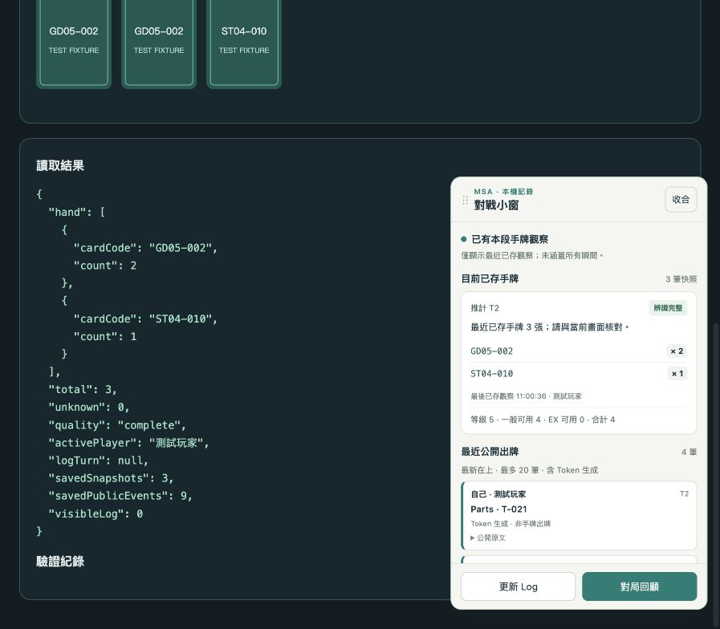
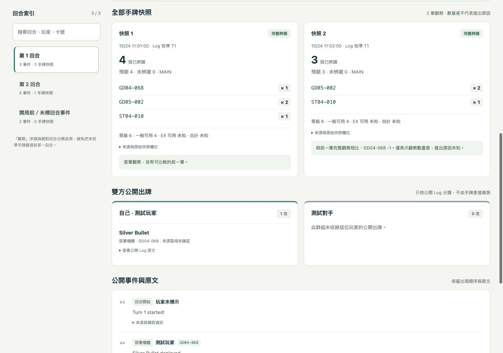

# MSA 手牌記錄器

在 Chrome 本機記錄 Mobile Suit Arena 中**自己可見的手牌**與**雙方公開的 Battle Log**。打牌時用頁面內的側邊小窗查看已存觀察，賽後按回合回顧，再匯出可離線閱讀的報告。

**[下載 v0.5.0 公開測試版 ZIP](https://github.com/tingwei1111/msa-hand-recorder/releases/download/v0.5.0/msa-hand-recorder-v0.5.0.zip)** · [版本下載頁](https://github.com/tingwei1111/msa-hand-recorder/releases/tag/v0.5.0) · [完整使用教學](docs/使用教學.md)

v0.5.0 為公開測試版（Prerelease），尚未完成真人實際對戰的端到端驗證。[查看版本紀錄](CHANGELOG.md)。

## 能做什麼

- **對戰側邊小窗：**在 MSA 對局頁點「對戰小窗」展開，即時檢查本段已成功儲存的手牌、一般／EX 資源及最近 20 筆公開出牌與 Token 生成。
- 保存已觀察到的手牌卡號、張數、時間、回合來源、辨識品質與資源，包含一般及 EX 可用資源。
- 在開局、結束的安全閒置時機，自動嘗試短暫顯示 Battle Log，讀取後恢復原狀；也能手動更新。
- 按回合檢視**每筆已儲存的手牌快照**與公開事件，標示數量差、未知資料與擷取缺口。
- 合併同一對局、同一玩家的相容記錄段落，下載 HTML、Markdown、JSON 或 CSV。HTML 包含完整可讀內容及可重新解析的原始 JSON。



*上圖使用合成示範資料，不是真實對戰紀錄。這是遊戲頁面內的小窗，並非桌面應用程式或作業系統的永遠置頂視窗。*

<details>
<summary>查看賽後回顧介面</summary>



合成資料示例。另見 [v0.4 擴充功能小視窗](docs/images/popup-v0.4.jpg)。

</details>

## 安裝到 Chrome

1. 下載上方 v0.5.0 公開測試版 ZIP；也可在版本下載頁的 **Assets** 選擇 `msa-hand-recorder-v0.5.0.zip`。備用方式是在本專案首頁按 **Code → Download ZIP** 取得程式碼。
2. 解壓縮到你會保留的固定資料夾，例如 `Documents/msa-hand-recorder`。不要直接從 ZIP 載入，也不要安裝後移動或刪除資料夾。
3. 在 Chrome 網址列輸入 `chrome://extensions`，開啟右上角「開發人員模式」。
4. 按「載入未封裝項目」，選取解壓後的 **`extension` 子資料夾**，不要選外層資料夾。
5. 釘選「MSA 手牌記錄器」，並在開局前重新整理已開啟的 MSA 分頁。

Release ZIP 的安裝位置是解壓後的 `msa-hand-recorder-v0.5.0/extension`。Download ZIP 也包含 `extension` 子資料夾，外層名稱可能不同。一般使用不需要 Node.js，也不需要安裝程式依賴。

## 一場對局怎麼用

1. **開局前：**確認「自動記錄」開關已開，並在「記錄設定」保留「自動收錄 Battle Log」，自己的手牌位置先保留「自動：下方玩家手牌」。
2. **開始打牌後：**點對局頁角落的「對戰小窗」，或在擴充功能按「顯示對戰側邊小窗 ↗」，在目前使用的 MSA 對局分頁展開。核對已存手牌的觀察時間、卡號與實際張數；第一次使用請在發牌、抽牌、出牌後各核對一次。
3. **賽後：**先保持 MSA 對局分頁開著，按側邊小窗的「對局回顧」或擴充功能的「開啟對局回顧」，保留「合併同對局的相容記錄段落」，選「獨立 HTML 報告」下載。
4. **下載前後：**確認匯出前刷新結果、Log 起尾及缺口警告，再到 Chrome 下載項目確認檔案已保存。

小視窗「進階備份與管理」的「下載 JSON／手牌 CSV」備份單一段落；需要整理跨重新整理後的同一場對局，請使用回顧頁的合併匯出。操作細節與疑難排解見[使用教學](docs/使用教學.md)。

側邊小窗可拖曳標題移動；聚焦標題後可用方向鍵移動、`Home` 重設位置，在小窗內按 `Esc` 收合。展開與位置會另外記住，不會改變錄製開關或刪除對局。遊戲對話框出現時，小窗會暫時隱藏讓路。

小窗顯示的是**本段已存資料，不是尚未儲存的當下畫面**。按「更新 Log」後會先等候約 0.9 秒再檢查安全讀取條件；操作中無法更新會顯示原因，不會強行打斷遊戲。Token 會標為生成，不當作從手牌出牌。

## 更新與資料

更新前先匯出重要記錄，再把新版 `extension` 的檔案更新到原來的同一資料夾。在 `chrome://extensions` 對原擴充功能按「重新載入」，並在下一場開局前重新整理 MSA 分頁。**不要先移除擴充功能**；移除或清除其資料可能刪掉本機記錄。

記錄存放在目前 Chrome 使用者設定檔內，沒有自動雲端同步或備份。工具讀取頁面已顯示的內容，不讀取對手隱藏手牌、不攔截遊戲連線，也不自動上傳記錄。**匯出報告包含自己的手牌與玩家資訊**，分享前請先確認內容。

## 使用限制

目前**尚未完成真人實際對戰的端到端驗證**，請先用測試對局人工核對。MSA 改版、背景節流、分頁關閉或動畫都可能造成缺漏；工具保存所有已儲存的觀察，不能保證捕捉每個瞬間。

沒有觀察到的歷史手牌無法補回。「公開 Log 已見開局與結束」不代表手牌全程完整；卡牌數量差也不代表已確認的抽牌、出牌或棄牌原因。部分辨識、未知回合與手牌擷取缺口會保留標示。

## 本機開發與介面預覽

開發請先 clone 儲存庫或使用 **Code → Download ZIP**；Release 安裝包只含擴充功能與教學。需要 Node.js 22 以上與 Python 3，沒有外部 npm 依賴。

```sh
npm test
npm run preview
```

開啟 `http://127.0.0.1:8768/demo/index.html`，使用合成示範入口檢視側邊小窗、擴充功能小視窗與回顧頁。`npm run preview` 使用 `scripts/preview_server.py` 啟動本機預覽；預覽不連線至 MSA，也不代表真人對戰已驗證。

小視窗及回顧頁可加上 `?scenario=empty`、`partial`、`no-log`、`save-error`、`storage-error`、`settings-error`、`segments` 或 `long` 檢查不同畫面。更改 HTML 後以 `npm run preview:sync` 同步；`npm run package` 產生安裝包。
