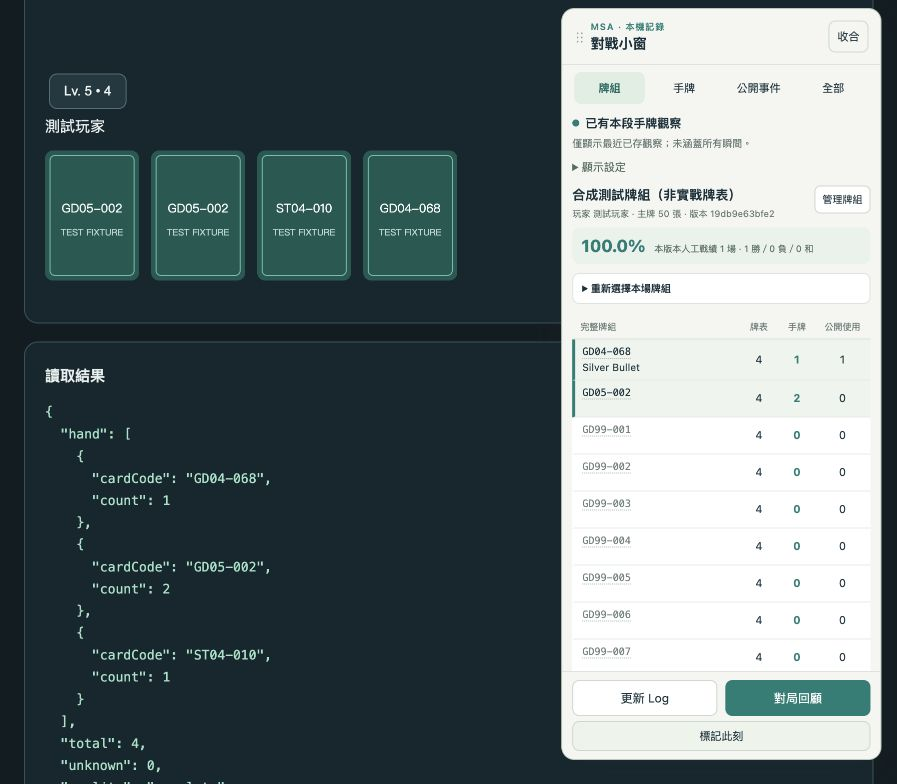
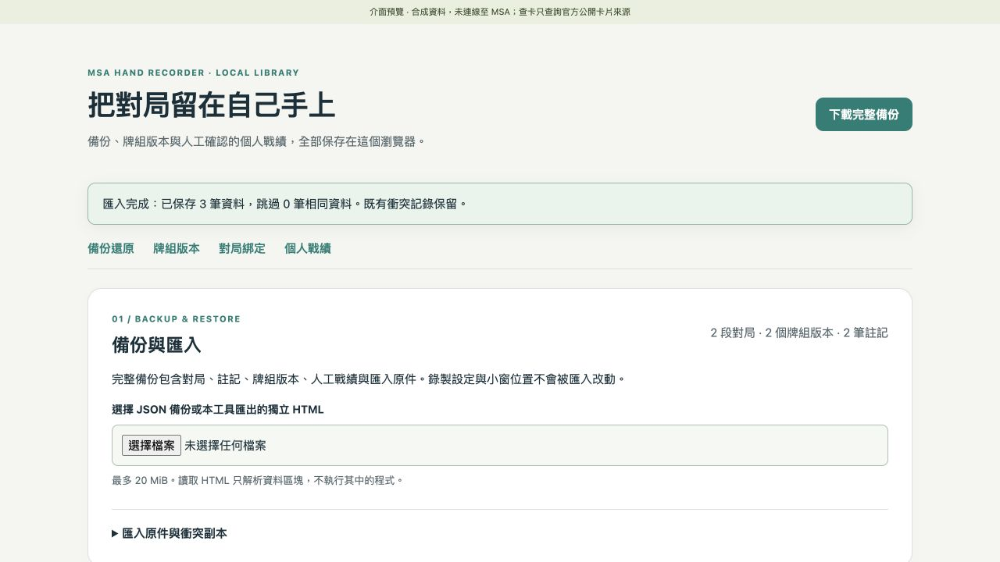

# MSA 手牌記錄器 · MSA Hand Recorder

**繁體中文** · [English](README.en.md)

在 Chrome 本機記錄 Mobile Suit Arena 的**本人可見手牌、雙方公開出牌與 Battle Log**。對戰中查看完整牌組卡列，賽後按回合回顧、標記決策並匯出資料，不必逐回合手動截圖。

這是為 GUNDAM CARD GAME（GCG）玩家製作的獨立社群工具，並非 Mobile Suit Arena 或 GUNDAM CARD GAME 的官方產品。

**[下載 v0.8.0](https://github.com/tingwei1111/msa-hand-recorder/releases/tag/v0.8.0)** · [完整繁中教學](docs/使用教學.md) · [English guide](docs/user-guide.en.md) · [問題回報](https://github.com/tingwei1111/msa-hand-recorder/issues) · [分享文案](docs/sharing.md)

## 目前狀態與語言

| 項目 | 狀態 |
| --- | --- |
| 版本 | **v0.8.0 Prerelease／公開測試版**；版本下載頁的 Assets 為已發佈安裝包。 |
| 文件 | 繁體中文與英文首頁、完整教學、卡片資料來源及開發說明。 |
| 擴充功能介面 | **目前仍是繁體中文**。英文教學附實際中文按鈕對照，尚無介面語言切換。 |
| 卡片預覽 | 小窗固定查詢官方繁中卡文；圖片可能是日文，文字與圖片語言分別標示。英文文件不會改變查卡語言。 |
| 使用環境 | 以桌面版 Google Chrome 為主要目標；其他瀏覽器、手機及平板未驗證。 |
| 驗證範圍 | v0.8.0 通過 367 項 JavaScript／Wasm、8 項 Rust 測試與 30 項合成瀏覽器錄製回歸。**尚未完成真人整場對戰的端到端驗證。** |

第一次使用請先用測試對局人工核對卡號、張數、回合與公開 Log。自檢通過或 Log 已見起尾，都不代表手牌全程完整。

## 為什麼使用這個工具

- **對戰中核對記錄：**小窗整合凍結牌組、已存手牌與雙方公開使用次數。
- **賽後回顧過程：**保留每筆成功儲存的手牌變化、原始公開文字與回合來源。
- **資料自己保存：**本機整理牌組版本、筆記與人工戰績，下載備份或離線報告。
- **看得出不確定性：**完整張數、部分已辨識下限與未知分開呈現，不把缺資料當成零張。



*截圖使用合成資料；v0.7 的牌組介面沿用於 v0.8.0。小窗在 MSA 分頁內顯示，尚未提供跨應用程式的系統層置頂。*

## 功能一覽

| 功能 | 可以做什麼 | 使用界線 |
| --- | --- | --- |
| 自動手牌記錄 | 保存本人可見手牌的卡號、數量、時間、品質、資源與回合來源。 | 只保留實際觀察並成功存入的內容；動畫、休眠、關頁或中途安裝可能造成缺漏。 |
| 雙方公開 Battle Log | 收錄公開出牌、主要卡號、原文與各自回合。 | 不讀對手隱藏手牌，不補回未觀察到的歷史手牌。 |
| 完整牌組卡列 | 綁定已存 50 張主牌版本，逐卡比較「牌表／手牌／公開使用」。 | 公開使用是累計次數，**不是剩餘牌庫**；Token 生成另列。 |
| 對戰小窗 | 牌組／手牌／公開事件／全部四分頁、拖曳、貼邊、字級、寬度與收合。 | 顯示已存觀察；收合不會暫停記錄。 |
| 官方單卡預覽 | 停留、聚焦或點擊卡號，查詢官方卡文與卡圖。 | 顯示來源、文字／圖片語言及擷取時間，未知內容不猜補。 |
| 回顧與筆記 | 按回合檢視、合併相容記錄段、搜尋、快照書籤及可編輯筆記。 | 原段落保留；手牌差值不判定抽牌、出牌或棄牌原因。 |
| 牌組版本與人工戰績 | 修改另存版本，對局保留凍結牌表；人工確認結果與先後手。 | 不自動猜勝負，未確認結果不列勝率分母，樣本數另列。 |
| 備份與還原 | 完整 JSON 備份；預覽後匯入本工具 JSON 或獨立 HTML。 | 衝突保留本機資料及匯入原件；多筆寫入不是原子交易。 |
| 匯出 | 獨立 HTML、Markdown、單場 JSON、手牌／公開事件／整合 CSV。 | HTML 可離線閱讀；報告可能包含手牌、玩家名稱及筆記。 |
| 記錄自檢 | 查看分頁版本、本人身分、待存筆數、儲存錯誤與 Log 狀態。 | 開關已啟用、提醒已收起或自檢通過，不等於全場無缺漏。 |



## 第一次安裝：只需要桌面版 Chrome

**一般使用者不必安裝 Rust、Node.js、Python 或本機伺服器。**安裝包已附本機 Wasm 核心。目前提供手動載入的 ZIP，沒有 Chrome Web Store 安裝或自動更新。

1. 到 [v0.8.0 下載頁](https://github.com/tingwei1111/msa-hand-recorder/releases/tag/v0.8.0)，展開 **Assets**，下載 `msa-hand-recorder-v0.8.0.zip`。
2. 解壓到固定資料夾，找到含 `manifest.json` 的 **`extension` 子資料夾**。
3. 在 Chrome 網址列**手動輸入** `chrome://extensions`，開啟「開發人員模式／Developer mode」。
4. 按「載入未封裝項目／Load unpacked」，選取 **`extension`**。
5. 釘選「MSA 手牌記錄器」，於開局前重新整理 MSA，再按「記錄自檢」。

```text
msa-hand-recorder-v0.8.0/
├── README.md
├── docs/
└── extension/              ← Chrome 選這一層
    ├── manifest.json
    └── wasm/
        └── deck_tracker_bg.wasm
```

不要直接載入 ZIP 或只複製單一 JavaScript；安裝後保留資料夾位置與完整檔案。**Code → Download ZIP** 是目前分支原始碼，可能含發佈後的文件變更；第一次安裝建議用 Releases 的版本 ZIP。

## 更新時保留原本記錄

1. 先到「資料與牌組」下載完整 JSON 備份，保留舊程式檔供回復。舊版若沒有完整備份按鈕，先使用它提供的 JSON 匯出保存已有記錄。
2. 找到 Chrome **目前使用的原路徑**：`chrome://extensions` →「MSA 手牌記錄器」→「詳細資料」→ 滑到最下方「來源」，找「**載入來源：／Loaded from:**」。它在「移除擴充功能」上方，點路徑可在系統檔案管理員中查看。
3. 把新版 `extension` 的**完整內容**更新到同一個原路徑，包含 `wasm`。
4. 在原擴充功能按「重新載入／Reload」，下一場前重新整理 MSA，核對版本並自檢。

不要先解除安裝，或用另一個資料夾另裝一份；不同擴充功能 ID 可能無法直接看到原記錄。完整步驟見[使用教學](docs/使用教學.md)。GitHub 文件更新或 Release 發佈**不會自動更新**已安裝版本。安裝包內附說明以發佈當時為準，最新雙語教學以本專案網頁為準。

## 第一場怎麼用

1. **準備：**在「資料與牌組」保存主牌 50 張的版本，資源與 Token 分欄。格式檢查不等於卡片存在、類型正確或符合當期賽制。
2. **開始觀察：**開啟自動記錄，核對本人玩家及手牌位置，建議保持自動收錄 Battle Log，再按「記錄自檢」。
3. **手牌存入後：**開小窗「牌組」，選版本並按「確認綁定本場牌組」，比對實際手牌與最後觀察時間。
4. **對戰中：**需要時查卡或「標記此刻」。待存筆數與錯誤提示不能當作保存成功。
5. **賽後：**保留對局分頁，按「更新 Log」，到「對局回顧」核對回合、起尾與缺口，再人工確認結果、備份或匯出。

詳細操作：[繁中完整教學](docs/使用教學.md)／[English step-by-step guide](docs/user-guide.en.md)。

## 讀懂數量與戰績

| 顯示 | 意義 |
| --- | --- |
| 牌表 `4` | 本場凍結版本中該卡有 4 張。 |
| 手牌 `2` | 最近已存且可核對的完整觀察中有 2 張。 |
| 手牌 `≥2` | 部分觀察至少辨識出 2 張，其餘仍未知。 |
| 手牌 `?` | 沒有可核對的手牌數，不能當作 0。 |
| 公開使用 `3` | 已收錄 3 次可辨認的公開使用，同卡回手後再用會再次計數。 |

不能用「牌表 − 手牌 − 公開使用」算精確剩餘牌庫；Shield、回手、洗回與來源區域可能未知。本人／對手無法確認時留在「待核對」。

人工戰績按同一 game／確認玩家去重，採用對局凍結版本。本人投降計負；總勝率包含確認和局於分母，決勝勝率排除和局；未確認結果兩者都不列入。

## 資料、權限與隱私

- **對局留在本機：**使用目前 Chrome 設定檔的擴充功能儲存，沒有自動雲端同步、對局上傳或線上分析服務。
- **只觀察可見內容：**不讀 Cookie、不攔截 WebSocket、不請求 MSA 私有 API、不讀對手隱藏手牌，也不替玩家操作遊戲。
- **單卡預覽會連網：**指定卡號／語言用於官方 `www.gundam-gcg.com` 公開查詢，不附帶對局、手牌清單、玩家名稱、憑證或 referrer。網站仍會收到一般網路連線資訊，並非匿名代理。
- **可核對權限：**`storage` 保存本機資料，MSA content-script 範圍用於觀察，官方卡片網站權限用於查卡。Wasm 隨包提供，不從 CDN 下載。
- **分享前檢查：**備份／報告可能含本人手牌、名稱、筆記及人工結果；本機保存與離線匯出不會自動匿名化。

來源與快取詳情：[繁中](docs/card-sources.md)／[English](docs/card-sources.en.md)。

## 常見問題

| 問題 | 先做什麼 |
| --- | --- |
| 找不到 `manifest.json` | 完整解壓並選內層 `extension`，不要選 ZIP 或外層資料夾。 |
| 更新後仍是舊版 | 核對「載入來源」原路徑，重新載入擴充功能，再重新整理 MSA。 |
| 如何切換英文介面 | 目前尚未提供，請用英文教學的中文按鈕對照。 |
| 只有手牌，Log 是零 | 保留對局頁，安全時按「更新 Log」或開遊戲 Battle Log，再核對已存事件。 |
| Wasm 載入中／失敗 | 確認完整 `extension/wasm` 已安裝，再重新載入擴充功能與 MSA。保留資料、不先解除安裝；手牌與 Log 記錄不依賴牌組引擎成功。 |
| 重新整理後少了一段 | 回顧頁合併相容段落，不能補回未觀察瞬間。 |
| 匯入只完成部分 | 保留原始檔，核對已存／未完成項目與容量，再重新預覽。 |
| 其他瀏覽器或手機能用嗎 | 目前未驗證，優先使用桌面版 Chrome。 |

更多診斷情境見[完整教學](docs/使用教學.md)。

## 回報、翻譯與分享

歡迎用**繁體中文或英文**到 [GitHub Issues](https://github.com/tingwei1111/msa-hand-recorder/issues) 回報版本、Chrome／作業系統、重現步驟、預期與實際結果，以及合成預覽能否重現。只附必要且已檢查的截圖或節錄，不要預設公開整份真實對局備份。

分享給其他國家玩家時，可傳 [English README](https://github.com/tingwei1111/msa-hand-recorder/blob/main/README.en.md)，或使用[雙語分享文案](docs/sharing.md)。歡迎提出 UI 翻譯與使用性建議；英文 UI 尚未實作。

操作體驗參考 [WaterStone](https://github.com/scriptLin-bjtu/WaterStone) 的窄長牌組卡列與懸停查卡；本工具自行實作 GCG 資料投影與 Chrome 介面。公開截圖與測試資料均為合成內容，官方卡圖與完整卡文資料集不整批隨包提供。

## 開發與驗證

合成預覽需要 Node.js 22 以上與 Python 3，沒有外部 npm 依賴；重建核心另需固定 Rust／Wasm 工具鏈，見[繁中開發說明](docs/Rust-Wasm.md)／[English developer notes](docs/Rust-Wasm.en.md)。

```sh
npm test
npm run preview
```

開啟 `http://127.0.0.1:8768/demo/index.html` 查看小窗、小視窗、回顧與管理頁。預覽不讀已安裝擴充功能的真實記錄。

Rust 處理牌組驗證、凍結版本選擇、手牌分類、公開卡／Token 彙整與同版本戰績；JavaScript 保留擷取、儲存、介面與宿主語義橋接。v0.8.0 沿用備份格式、沒有資料庫遷移，也不宣稱速度提升。

[版本紀錄（繁中）](CHANGELOG.md) · [Releases／雙語 v0.8.0 說明](https://github.com/tingwei1111/msa-hand-recorder/releases/tag/v0.8.0)
