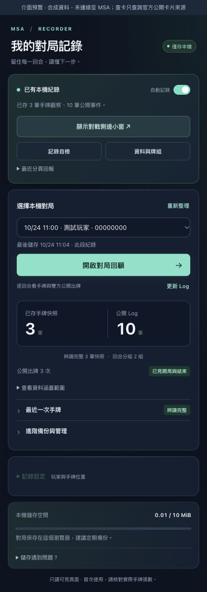
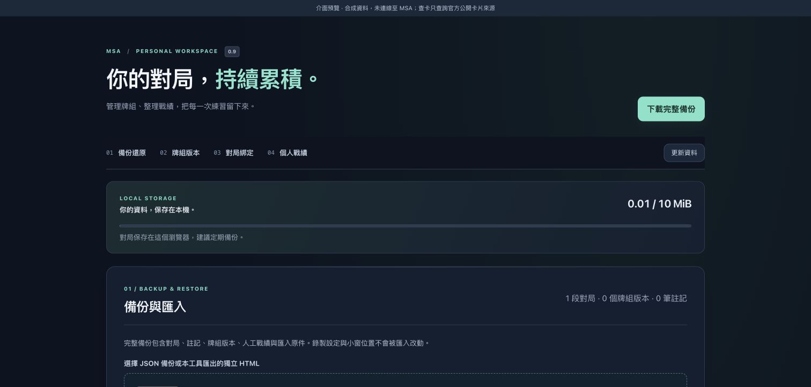

# 分享 MSA 手牌記錄器 · Share MSA Hand Recorder

[繁中首頁](../README.md) · [English README](../README.en.md) · [繁中教學](使用教學.md) · [English guide](user-guide.en.md)

以下文案可自行複製、修改；此文件不會替你發文。分享時保留公開測試版、繁中介面與捕捉限制，圖片使用合成示範或先檢查自己的資料。

These drafts are ready to copy and adapt. This file does not post anything automatically. Keep the prerelease status, current interface language, and capture limitations visible. Use synthetic screenshots or review your own data first.

## 繁體中文：短版

> 分享一個給 Mobile Suit Arena／GUNDAM CARD GAME 玩家使用的 Chrome 本機記錄器：不用逐回合截圖，可以保存本人可見手牌與雙方公開 Battle Log，在小窗查看牌組、已存手牌與公開使用，賽後按回合回顧並匯出。以 MIT 授權開源，歡迎 Fork、改進與回報問題。提供繁中與英文教學，介面目前仍是繁中。v0.10.0 為公開測試版，尚未完成真人整場驗證，不會讀對手隱藏手牌或計算精確剩餘牌庫。
>
> 介紹與安裝：https://github.com/tingwei1111/msa-hand-recorder

## English: short introduction

> I’m sharing MSA Hand Recorder, a local Chrome tool for Mobile Suit Arena / GUNDAM CARD GAME players. It saves your visible hand and both players’ public Battle Log, adds an in-page deck panel, and exports records for turn-by-turn review—without a screenshot every turn. The project is open source under the MIT License; forks, improvements, and feedback are welcome. English and Traditional Chinese guides are available; the interface supports Traditional Chinese, Simplified Chinese and English. v0.10.0 is a prerelease, and a complete real-player match has not yet been validated end to end. It does not reveal hidden opponent hands or calculate an exact remaining deck.
>
> English introduction and installation: https://github.com/tingwei1111/msa-hand-recorder/blob/main/README.en.md

## 繁體中文：社群貼文

我想分享正在開發的 **MSA 手牌記錄器**，讓 GCG 玩家在 Mobile Suit Arena 練習後，更容易回顧自己的決策。

- 自動保存本人可見手牌的卡號、數量與已存變化。
- 記錄雙方公開出牌及 Battle Log，保留原文與回合來源。
- 對戰小窗查看完整牌組卡列、已存手牌、累計公開使用及 Token。
- 保存快照書籤、筆記、牌組版本及人工確認戰績。
- 完整 JSON 備份，也可匯出 HTML、Markdown 與 CSV 供賽後整理。

資料保存在目前 Chrome 設定檔，沒有自動對局上傳；單卡預覽會查詢官方公開卡片網站。這是獨立社群工具，目前是 **v0.10.0 公開測試版**，介面為繁體中文，另有完整英文教學。

歡迎先用測試對局核對並回報問題。未觀察到的歷史手牌無法補回，公開使用次數也不代表剩餘牌庫。真人整場記錄尚未完成端到端驗證，匯出檔也不會自動匿名化。

本專案以 **MIT 授權開源**，歡迎使用、修改、Fork 與提交 PR。參與方式請看 CONTRIBUTING.md。

專案：https://github.com/tingwei1111/msa-hand-recorder

安裝包：https://github.com/tingwei1111/msa-hand-recorder/releases/tag/v0.10.0

## English: community post

I’d like to share **MSA Hand Recorder**, a Chrome tool I’m developing to make post-match review easier for GCG players practicing on Mobile Suit Arena.

- Save your visible hand by card number and quantity, including saved changes within a turn.
- Record both players’ public plays and Battle Log with original text and turn sources.
- Use an in-page panel for your saved deck list, observed hand, cumulative public uses, and generated Tokens.
- Keep snapshot bookmarks, notes, deck versions, and manually confirmed results.
- Back up to JSON or export HTML, Markdown, and CSV for later review.

Records stay in the current Chrome profile without automatic match uploads. Single-card previews request public information from the official card website. This is an independent community project, currently **v0.10.0 Prerelease**. The interface supports Traditional Chinese, Simplified Chinese and English, with a saved language selector and full bilingual guides.

Please try a practice match first and compare records manually. Unseen historical hands cannot be recovered, and public-use counts are not an exact remaining deck count. A complete real-player match has not yet been validated end to end. Exports are not automatically anonymized.

The project is **open source under the MIT License**. You can use, modify, fork, and submit improvements; see CONTRIBUTING.md.

English guide: https://github.com/tingwei1111/msa-hand-recorder/blob/main/README.en.md

Download: https://github.com/tingwei1111/msa-hand-recorder/releases/tag/v0.10.0

## 示範圖片 · Suggested screenshots

以下圖片為合成資料及繁中介面。These screenshots use synthetic data and the Traditional Chinese interface.

## 回報入口 · Feedback

回報時附版本、環境及重現步驟；真實備份可能含手牌、名稱與筆記，先檢查再分享。

Include versions, environment, and reproduction steps. Real backups may contain hands, names, and notes; review them before sharing.

[GitHub Issues — 繁體中文／English](https://github.com/tingwei1111/msa-hand-recorder/issues)
