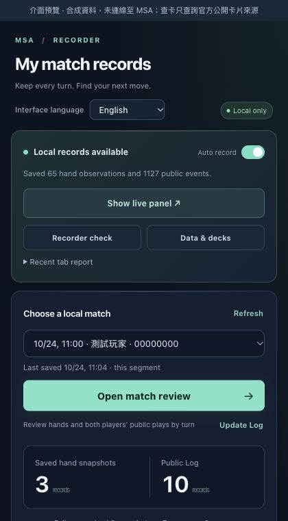

# v0.10.0 — 三語介面 / Three-language interface

[繁體中文首頁](../README.md) · [English README](../README.en.md) · [安裝包 / Release](https://github.com/tingwei1111/msa-hand-recorder/releases/tag/v0.10.0)

## 繁體中文

新增 **繁體中文、简体中文、English**。小視窗、對局回顧與資料管理頁頂端可選擇「介面語言」；對戰小窗則在「顯示設定」中切換。

- 首次依瀏覽器偏好選擇語言；明確保存的選擇優先，並同步已開啟頁面。
- 翻譯按鈕、提示、錯誤、自檢、容量、資源、牌組與無障礙標籤；日期顯示跟隨語言。
- 不需為切換語言重新整理 MSA，不重啟正在進行的記錄。保留選取的對局、搜尋、未保存牌組／戰績及筆記草稿。
- 語言保存為獨立本機偏好；匯入對局備份不會覆蓋語言或錄製設定。
- 英文查卡使用官方英文來源；兩種中文介面使用官方繁中來源，不自行轉換官方卡文，並分開標示文字與圖片語言。
- 支援 Chrome 擴充功能名稱／說明的三語 metadata；此清單依 Chrome 本身語言，獨立於工具內偏好。
- 沿用原本權限、紀錄 schema 與 Wasm binary。

玩家名稱、筆記、卡片名稱／官方卡文、Battle Log、原始 JSON 與 CSV 欄位不會因介面切換被改寫。獨立 HTML／Markdown 匯出目前沿用原有繁中報告標題格式。

### 驗證

386 項 JavaScript／Wasm 測試通過，包含 11 項字典與參數完整性、預設語言、跨頁同步、競態、失敗處理及原文保留檢查。另在 Chrome 以合成資料實測三語切換、跨頁同步、表單／筆記草稿與搜尋保留、版面及 30 項錄製回歸（30 passed / 0 failed）。

完整真人整場錄製仍未驗證；成功自檢或公開 Log 已見起尾，不代表所有手牌時點都已收錄。



[簡中預覽](images/popup-v0.10-zh-CN.png) · [英文回顧](images/review-v0.10-en.png) · [英文資料管理](images/library-v0.10-en.png)

## English

Choose **English**, **繁體中文** or **简体中文** under **Interface language** at the top of the popup, match review or workspace. In the live panel, open **Display settings**.

The initial choice follows your browser language. A saved choice takes priority and synchronizes open extension views immediately. Switching keeps the active recording, selected match, search filters and unsaved deck, result and note drafts. Backup imports do not overwrite this preference.

Buttons, hints, diagnostics, errors, storage, resources, deck explanations, dates and accessibility labels are localized. English card lookup uses the official English source; either Chinese UI uses the official Traditional Chinese source. Card text is never converted into unofficial Simplified Chinese, and text/image languages are reported separately.

Names, notes, official card content, original Battle Log and raw JSON/CSV fields retain their original content. Standalone HTML/Markdown retain the existing Traditional Chinese report-heading template. Chrome’s own extension-manager name follows Chrome’s language separately. Permissions, record schemas and the Wasm binary are unchanged.

**Validation:** 386 JavaScript/Wasm tests pass, including 11 locale, synchronization, failure, placeholder and data-preservation tests. Chrome checks use synthetic data, covering all three languages, cross-page switching, drafts, filters and 30 recording regression checks (30 passed / 0 failed). A complete real-player match has not been validated end to end.

### Updating

Download `msa-hand-recorder-v0.10.0.zip` from release **Assets**. Back up existing records, replace the complete contents of the original `extension` folder, reload the **existing** entry in `chrome://extensions`, and refresh MSA before the next match. Keep the same extension entry to retain access to its data. Publishing a release does not update an installed extension automatically.

### Translation contributions

Edit `extension/locales/en.json` or `extension/locales/zh-CN.json`, preserve placeholders and whitespace, then run:

```sh
python3 scripts/build_i18n.py
npm test
python3 scripts/sync_previews.py --check
```

The 1,060 source messages use Traditional Chinese as their stable keys. Only recorder-authored UI is translated; user content and original match evidence bypass translation.
