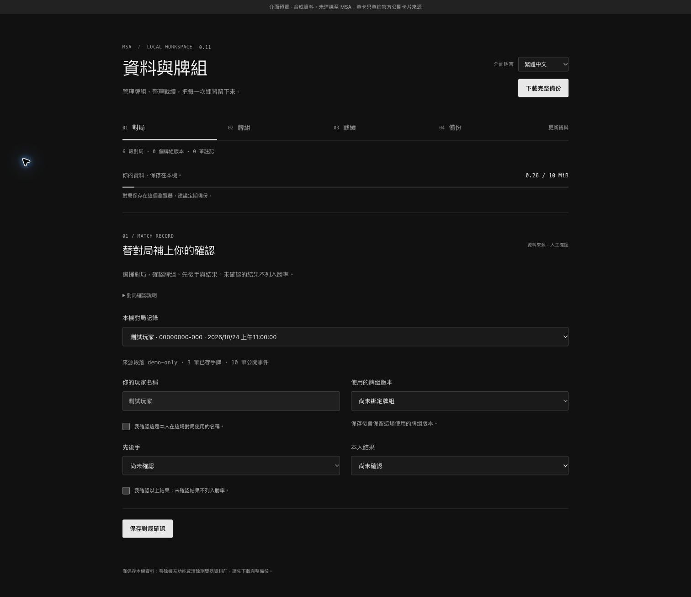

# v0.11.0 · 簡約介面、三語報告與持久化救援

[繁中首頁](../README.md) · [English](#english) · [下載安裝包](https://github.com/tingwei1111/msa-hand-recorder/releases/tag/v0.11.0)

## 這次改了什麼

- **簡約介面：**小視窗、對戰小窗、回顧、資料管理及離線 HTML 改用深灰、灰白文字、細線與留白。主要操作清楚保留，錯誤與待確認狀態使用語意色，鍵盤焦點仍可見。參考 [Ryo Lu 的日誌](https://ryo.lu/journal/struggle-together) 的視覺方向，自行實作，使用本機系統字型。
- **資料管理分頁：**對局／牌組／戰績／備份；切換頁籤、語言或返回上一頁時保留目前未保存的表單與匯入預覽，提供方向鍵、Home／End 導覽。關閉頁面前仍需保存。
- **三語報告：**HTML／Markdown 的標題與工具說明採按下匯出時的繁中、簡中或英文。玩家名稱、筆記、官方卡文與 Battle Log 原文保持不變；JSON／CSV 原始欄位不翻譯。HTML 可離線閱讀、列印及還原一般備份。
- **狀態與語系修正：**隔離原件不再被一次成功刷新隱藏；待存、救援、Log 數量等狀態分別翻譯，插入的原文不二次翻譯。切換語言同步更新回顧的日期選單與快取狀態，不清除選取、搜尋或草稿。
- **減少重複工作：**突發觀察以約 100 ms、最多 16 筆、約 512 KiB 合併 session 寫入，保留全部中間狀態及合法重複事件。寫入序號和來源跟 session 一起保存，失去回覆後重試不重複加入 A → B → A。收起小窗只投影狀態摘要，展開立即取得完整資料。
- **持久化救援：**新觀察先嘗試寫入獨立 IndexedDB；交易完成才確認已持久化，正常存入對局後清理對應暫存。重整或原分頁關閉後仍可下載已持久化原件，不自動重播或猜補歷史。

[英文小視窗](images/popup-v0.11-en.png) · [英文回顧](images/review-v0.11-en.png) · [英文離線報告](images/report-v0.11-en.png)

## 救援的使用界線

正常 session、一般備份及既有資料相容，不搬移舊紀錄；新增的是獨立救援資料庫與 `msa-unsaved-rescue` 第 2 版。沒有新增擴充功能權限，Rust／Wasm binary 未改動。

救援區上限為 **16 MiB／512 筆，單筆 2 MiB**，不自動淘汰。正常保存成功才清除相應項目；隔離原件、回覆或清理失敗時可能保留。**下載不會清空救援區，本版沒有清理介面。**滿載後一般保存仍會嘗試，但新原件無法取得救援保護；應保留分頁並核對待存／錯誤提示。容量條只計一般 Chrome 儲存，不含救援區。

救援 JSON 包含已持久化原件及目前選取的 MSA 分頁中可取得的暫存；其他分頁尚未持久化的資料需分別切換下載。部分原件可能已在正常存檔，需人工核對；它不是一般備份匯入格式。一般完整備份不包含救援區，更新或移除前若有救援原件應另行下載。

救援不能補回未觀察或尚未落盤的最後一筆資料。已保存的救援原件也不等於已確認對局紀錄，不加入手牌數量或戰績。

## 驗證與量測

- `npm test`：**430／430 通過**，含實際打包 Wasm 相容性、三語報告原文與還原、批次重試、隔離、IndexedDB 交易 abort／容量／來源檢查、語言快取與頁籤導覽。
- Chrome 合成錄製回歸：**30／30 通過**；另驗證 IndexedDB 寫入完成 → 重新整理 → 同一 game／run／sequence 讀回。
- 介面核對：繁中／簡中／英文、360 px 窄視窗無橫向溢出、頁籤鍵盤導覽、戰績／牌組草稿保留、回顧搜尋與日期更新、實際英文 HTML 下載及原始內容保留。
- 64 筆突發合成觀察：session 寫入 **64 → 4** 次，提交的 session JSON **948,991 → 72,748 bytes**。只計 session JSON，不含救援、狀態或實體磁碟 I/O；相隔超過批次窗口的單筆仍寫完整 session。
- 500 個快照／351 個公開事件，預熱 8 次、量測 30 次：展開投影 median **0.924 ms**／p95 **1.251 ms**；收合 **0.005 ms**／**0.007 ms**。執行 `node scripts/benchmark_live_panel.cjs` 可重測。這是本機純投影量測，不含 DOM、儲存或真人遊戲，結果依環境變動。

**尚未完成真人整場對戰的端到端驗證。**測試、快照增加與公開 Log 起尾不證明每次手牌變化都被觀察；不讀對手隱藏手牌，也不計算精確剩餘牌庫。

## 更新

先下載完整備份；若有待存／救援原件再下載救援 JSON。保留舊程式檔，把安裝包 `extension` 的完整內容放回原安裝資料夾，再於 Chrome 重新載入原擴充功能，下一場前重新整理 MSA、核對版本與自檢。不要先解除安裝或另載入不同路徑。**GitHub 上傳不會自動更新已安裝的 Chrome 外掛。**

## English

v0.11.0 is a prerelease with a minimal monochrome interface, Matches / Deck / Results / Backups tabs, and Traditional Chinese, Simplified Chinese and English HTML/Markdown reports. The visual direction takes inspiration from [Ryo Lu’s journal](https://ryo.lu/journal/struggle-together); all UI code is implemented here with local system fonts.

Tabs retain unsaved forms and import previews, support arrow/Home/End navigation and browser history, and work at narrow widths. Language changes update dates and cached status messages without losing selection, search or drafts. Save before closing a page. Export headings follow the language selected at click time. Names, notes, official card text, raw Battle Log, and JSON/CSV evidence remain unchanged.

Recording now batches bursts within approximately 100 ms, at most 16 observations / about 512 KiB, retaining intermediate observations. Session commits include source-bound sequence checkpoints, so retries after a lost acknowledgement do not duplicate A → B → A history. A collapsed panel projects only its summary; expansion immediately rebuilds the full view. Quarantined originals keep capture status partial even when a later Log refresh succeeds.

### Recovery boundaries

An independent IndexedDB journal stages new observations, acknowledging protection only after transaction completion. Successful normal session commits remove corresponding entries. Retained originals can be downloaded after reload or when the original tab is gone; they are never replayed automatically.

Limits are **16 MiB / 512 entries, 2 MiB per entry** with no automatic eviction. **Downloading does not clear entries; this version has no journal cleanup interface.** A full journal stops durable staging of new originals while normal saves are still attempted. Keep the original tab and inspect pending/error status. The normal storage meter excludes this journal.

Rescue JSON v2 combines journal originals with available memory from the currently selected MSA tab. Switch to other tabs separately for their not-yet-persisted buffers. Originals may duplicate normal records and require manual inspection; they are not standard importable backups or confirmed hand/statistical data. Standard full backups exclude the journal, so download rescue JSON separately when needed. Unseen or not-yet-committed observations cannot be recovered.

Existing sessions and standard backups remain compatible without moving old data. Permissions and the packaged Rust/Wasm binary are unchanged.

### Validation

**430/430 JavaScript/Wasm tests** and **30/30 synthetic Chrome recording checks** passed. Separate browser checks cover actual IndexedDB stage → reload → read, three languages, 360 px layout, keyboard navigation, draft preservation, date/search continuity and an actual English HTML download with original content.

A synthetic 64-observation burst reduced session commits from **64 to 4** and submitted session JSON from **948,991 to 72,748 bytes**. This excludes journal/status traffic and physical I/O; slow observations still write a full session. A local 500-snapshot / 351-event projection benchmark (8 warmups, 30 runs) measured expanded median/p95 **0.924/1.251 ms**, collapsed **0.005/0.007 ms**. Reproduce with `node scripts/benchmark_live_panel.cjs`; this excludes DOM, storage and gameplay and varies by environment.

**A complete real-player match remains unverified end to end.** Synthetic tests and public Log start/end markers do not prove complete capture. No hidden opponent hand access or exact remaining-deck calculation is provided.

Back up first, retain old files, replace the full contents of the original installation folder, reload the existing extension entry, and refresh MSA before your next match. A GitHub release does not automatically update an unpacked extension. See the [full English guide](user-guide.en.md).
