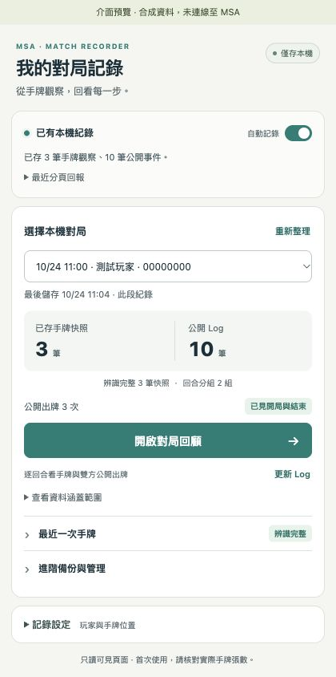

# MSA 手牌記錄器使用教學

這份教學適用於 Chrome 與 v0.4.0 公開測試版（Prerelease）。工具記錄自己畫面上可見的手牌，以及雙方公開的 Battle Log，供賽後回顧。第一次使用請先做一場測試對局，人工核對記錄；目前尚未完成真人實際對戰的端到端驗證。

[回到專案首頁](../README.md) · [v0.4.0 版本下載頁](https://github.com/tingwei1111/msa-hand-recorder/releases/tag/v0.4.0) · [直接下載 ZIP](https://github.com/tingwei1111/msa-hand-recorder/releases/download/v0.4.0/msa-hand-recorder-v0.4.0.zip)

## 1. 下載與安裝

1. 開啟上方版本下載頁，在 **Assets** 下載 `msa-hand-recorder-v0.4.0.zip`，或使用直接下載連結。備用方式是在專案首頁按 **Code → Download ZIP**。
2. 解壓縮到固定資料夾，例如 `Documents/msa-hand-recorder`。外層資料夾名稱可能附帶版本或分支名稱，這不影響安裝。
3. 找到解壓後的 `extension` 子資料夾，確認裡面有 `manifest.json`。
4. 在 Chrome 網址列輸入 `chrome://extensions`，開啟右上角「開發人員模式」（Developer mode）。
5. 按「載入未封裝項目」（Load unpacked），選擇 **`extension` 子資料夾**。
6. 點 Chrome 工具列的擴充功能選單，釘選「MSA 手牌記錄器」。
7. 在開局前重新整理 MSA 分頁，讓頁面載入擴充功能。

資料夾結構大致如下；請選最後一層 `extension`，不是外層或 ZIP 檔案。

```text
msa-hand-recorder-v0.4.0/
├── README.md
├── docs/
└── extension/       ← Chrome 載入這個資料夾
    ├── manifest.json
    └── …
```

安裝後要保留此資料夾的位置與檔案。一般玩家不需要執行 `npm install`、安裝 Node.js 或啟動伺服器。

## 2. 開局前設定

點開擴充功能，確認「自動記錄」開關已開。開關只代表啟用；「已有本機紀錄」和下方筆數才表示已有資料存入，仍需在對局中核對卡號與張數。等待資料、儲存異常與讀取失敗會另外標示。

展開「記錄設定」：

- **我的玩家名稱：**可填自己的 MSA 名稱，協助鎖定本人。
- **我的手牌位置：**先使用「自動：下方玩家手牌」。只有確定自己的手牌在何處時，才手動指定上方或下方；不要把旁觀畫面中的對手手牌指定為本人。
- **自動收錄 Battle Log：**預設開啟，建議保留。修改後按「儲存設定」。

自動收錄會在開局、結束的安全閒置時機，嘗試短暫顯示已辨識的 Log 控制項，讀取後恢復先前狀態。原本就開著 Log 時會直接讀取。輸入中、有其他對話框或處於不宜打斷的動作階段時，工具可能無法刷新，應查看結果與原因。

關閉「自動收錄 Battle Log」只停用開局與結束的自動顯示。你明確按「更新 Log」或下載匯出時，仍會嘗試在安全時機短暫顯示 Log 並恢復。

## 3. 確認真的有記到

第一次發牌後，點開擴充功能，展開「最近一次手牌」並核對：

1. 選到的對局與玩家是自己正在玩的這一場。
2. 人工數一遍畫面上的手牌，再對照已辨識張數、預期總數、未辨識張數與卡號。不要只比較工具計算出的兩個數字。
3. 抽牌或出牌後，最近快照內容及筆數有更新。
4. 公開事件筆數有增加，回合來源與實際遊戲相符。

若沒有讀到公開事件，保持對局分頁開著，按「更新 Log」。也可自行顯示 Log；使用快捷鍵 `L` 前先移開聊天或表單的輸入焦點。

擴充功能小視窗可以關閉，對局分頁保持開啟時仍會觀察；但背景分頁節流、瀏覽器休眠或頁面動畫可能造成缺漏。請盡量讓對局分頁保持正常運作。

重新整理頁面、改變玩家設定或暫停後恢復，可能建立新記錄段落。舊段落會保留，同一場對局可在回顧頁合併相容段落。



*上圖為合成示範資料。設定與備份可展開，啟用開關和保存結果分開呈現。*

## 4. 賽後回顧並下載 HTML

1. **先保持 MSA 對局分頁開著。**工具會嘗試收錄結束時的公開 Log。
2. 在擴充功能選取這場的記錄，按「開啟對局回顧」。
3. 保留「合併同對局的相容記錄段落」。這只合併同一對局、同一已確認玩家的手牌與相容公開 Log，不會覆寫原段落。
4. 查看公開 Log 是否已見開局、結束，以及是否有公開紀錄或手牌擷取缺口。
5. 選「獨立 HTML 報告」並按「匯出 HTML 報告」。工具會先要求對應分頁刷新，等儲存完成，再重讀本機資料建立這次匯出。
6. 查看匯出前刷新結果，再到 Chrome 下載項目確認檔案已保存。下載完成後可離線開啟 HTML。

若分頁關閉、刷新逾時或無法安全顯示 Log，仍可匯出既有資料；報告會標出結果與原因。這不表示已補齊缺漏。確認報告內容後，再關閉對局分頁。


*此圖為合成示範資料，不是真實對戰。*

回顧頁左側可選回合，或搜尋回合、玩家、卡名及卡號；按「清除」回到全部回合。可用「上一回合／下一回合」依目前搜尋結果切換，左側回合索引也支援鍵盤上下鍵、Home 與 End。

每個回合的「手牌快照／雙方出牌／公開事件」捷徑可直接跳到對應段落。全部已儲存手牌快照直接排列；首末摘要及原始欄位可展開核對。下載不受目前搜尋條件影響，匯出時會顯示準備狀態並暫時鎖定對局選擇，避免選錯範圍。

## 5. 讀懂報告標示

| 標示 | 如何解讀 |
| --- | --- |
| 最早／最晚觀察 | 這個回合第一次及最後一次被工具觀察到的手牌，不保證是真正回合開始與結束手牌。 |
| 全部手牌快照 | 每筆已儲存的觀察，包含中間狀態、卡號數量、時間、回合來源與品質。 |
| 完整辨識 | 這次快照符合辨識條件；仍應在初次使用時人工核對。 |
| 部分辨識／無法辨識 | 不能把已知卡號當作全部手牌；沒有卡號也不代表空手。 |
| Log 校準 | 回合資訊直接來自當時可見的公開 Log。 |
| 推計第 N 回合 | 由先前資訊推進的回合數，這次沒有直接從 Log 確認。 |
| 觀察回合 | 工具自己的觀察序號，尚未對齊遊戲絕對回合；不同記錄段落不會任意接成同一回合。 |
| 快照差值 | 相鄰且完整、同來源段落的觀察數量差。增加或減少不代表已確認抽牌、出牌或棄牌原因。 |
| 公開 Log 已見起尾 | 已擷取的公開事件涵蓋開局與結束；不保證手牌全程完整，也不等於伺服器端完整性保證。 |
| 手牌擷取缺口 | 切換對局或緩衝區滿載等情況留下的待存缺口；即使後來取得完整公開 Log，也無法補回。 |
| 首次擷取時間 | 工具第一次讀到公開事件的時間，不是事件實際發生時間。 |

資源分列為**等級、一般可用、EX 可用、合計可用**。一般可用不包含另列的 EX；舊記錄未保存 EX 欄位時顯示未知，不能當作 0。

公開部署／使用事件只依 Battle Log 分類。Token 生成不視為玩家從手牌出牌；基地等事件也可能來自其他效果，因此不把每項部署都當作手牌消耗。

賽後才取得完整 Log，仍不能精確回填先前沒有校準的手牌回合。中途安裝、暫停、分頁關閉或尚未開始記錄前的歷史手牌，均無法事後還原。

## 6. 選擇匯出格式

| 需求 | 建議格式 |
| --- | --- |
| 保存及閱讀整場已收錄資料 | 回顧頁合併相容段落後，下載獨立 HTML。包含所有已儲存快照、公開事件與原始 JSON。 |
| 交給文字分析工具 | 回顧頁的 Markdown 或 JSON。Markdown 逐筆列出手牌與事件；JSON 保留原欄位與合併來源。 |
| 用試算表整理 | 手牌 CSV、公開事件 CSV，或手牌＋事件整合 CSV。依欄位區分來源，勿把擷取時間當作事件時間。 |
| 備份單一記錄段落 | 小視窗「進階備份與管理」的「下載 JSON」或「手牌 CSV」。這不一定涵蓋同場跨重新整理後的全部段落。 |

HTML 可離線閱讀，不載入外部圖片或字型。內含 `msa-record-data` 與 `msa-export-info` 兩個非執行型 JSON 區塊，供工具重新解析完整記錄與匯出資訊。

## 7. 更新版本，保留原來的記錄

1. 先匯出重要對局，保留下載檔。
2. 下載新版 ZIP，解壓到暫時位置。
3. 將新版 `extension` 裡的檔案更新到**原來同一個 `extension` 資料夾**，維持原安裝路徑。
4. 開啟 `chrome://extensions`，對原本的「MSA 手牌記錄器」按「重新載入」。
5. 在下一場開局前重新整理 MSA 分頁，核對版本、記錄開關與一次手牌快照。

**不要先按「移除」再重裝。**重新載入原擴充功能會保留其本機儲存資料；解除安裝或清除資料可能刪除記錄。不要在重要對局途中更新，避免額外缺口。

## 8. 資料保存與隱私

資料保存在目前 Chrome 使用者設定檔的擴充功能儲存空間。沒有自動雲端同步或備份；換電腦、換 Chrome 使用者設定檔、解除安裝或清除資料，都可能無法取得原記錄。

工具讀取頁面已顯示的內容，不讀 cookie、不攔截 WebSocket、不請求 MSA 後端或讀取對手隱藏手牌。記錄、回顧及匯出在本機進行，不會自動上傳記錄；也不會代替玩家出牌或對其他玩家傳訊息。

**報告含有自己的手牌、玩家名稱與對局資訊。**分享前請先檢查；本機儲存不等於匯出檔已匿名化。刪除本機記錄前應先備份需要保留的內容。

## 9. 疑難排解

| 情況 | 可以先做的檢查 |
| --- | --- |
| Chrome 說找不到 manifest | 確認 ZIP 已解壓，且載入的是內含 `manifest.json` 的 `extension` 子資料夾。 |
| 沒有記錄 | 核對記錄開關，重新整理 MSA 分頁，確認自己的手牌已顯示，再看最近分頁狀態。 |
| 玩家或手牌側不對 | 核對玩家名稱與手牌位置，優先使用自動設定，儲存後人工核對新快照。 |
| 卡號缺少或張數不符 | 等牌面載入，確認可見位置與縮放，查看辨識原因；不要把未知補成 0。 |
| 只有手牌，沒有公開事件 | 保持對局開著，按「更新 Log」；必要時自行顯示 Log，再看事件筆數。 |
| 匯出顯示未能刷新 | 核對對局分頁仍開著、新版擴充功能已重新載入，且頁面沒有等待操作。既有資料仍能匯出，但不能視為已補齊。 |
| 完整 Log 搭配未校準手牌 | 早期手牌沒有可靠對齊資訊，賽後 Log 無法精確補回；請保留原標示。 |
| EX 顯示未知 | 舊記錄沒有 EX 資訊，或這次未能辨識；不能事後猜值。 |
| 合併後有缺口警告 | 查看來源段落、原始公開事件及手牌擷取原因；不要只以事件總數判定完整。 |
| 按下載卻找不到檔案 | 查看 Chrome 下載項目與攔截提示。「已發起下載」不代表檔案已保存。 |
| 無法儲存資料 | 查看擴充功能錯誤訊息與 Chrome 儲存狀態，先備份可讀記錄，避免直接解除安裝。 |

MSA 改版、瀏覽器背景節流、休眠、分頁關閉與動畫仍可能造成未觀察的瞬間。需要回報問題時，先整理版本、Chrome 版本、操作步驟、預期與實際結果；分享截圖或報告前先確認個人資訊與手牌內容。
